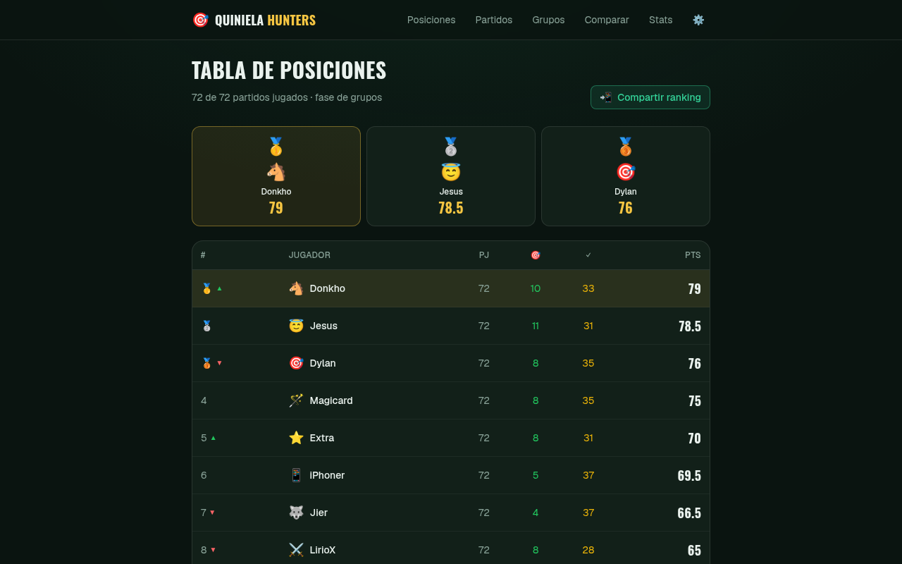
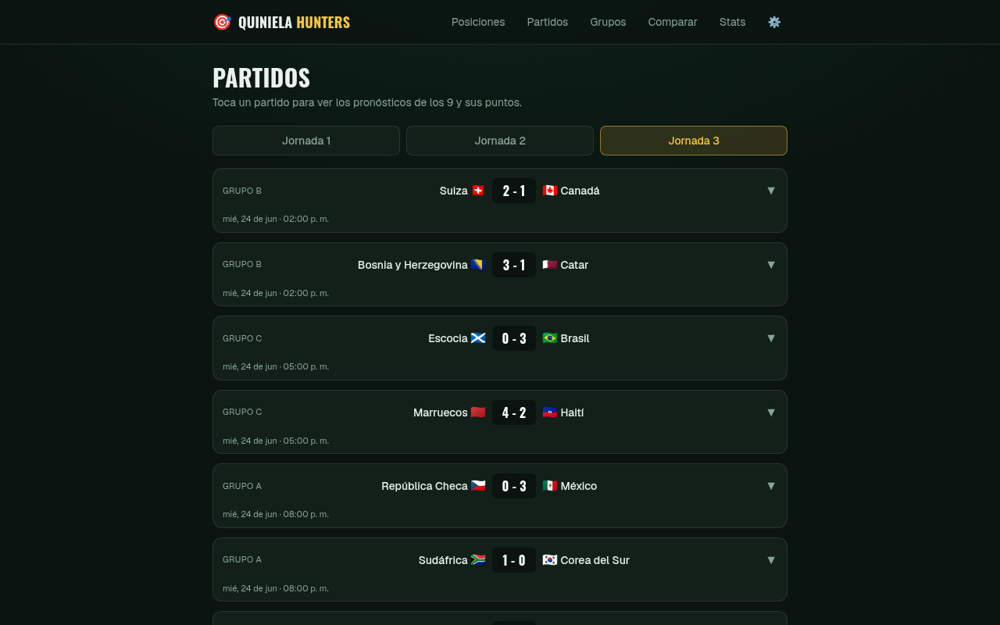
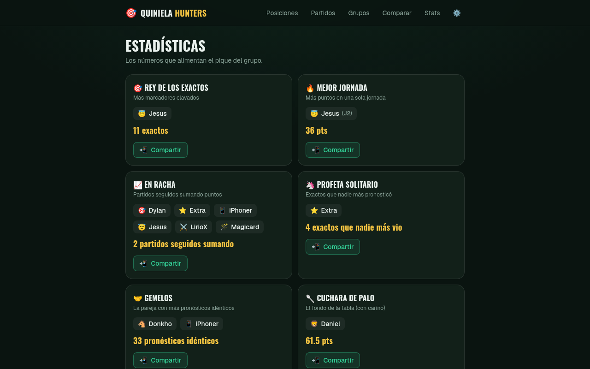
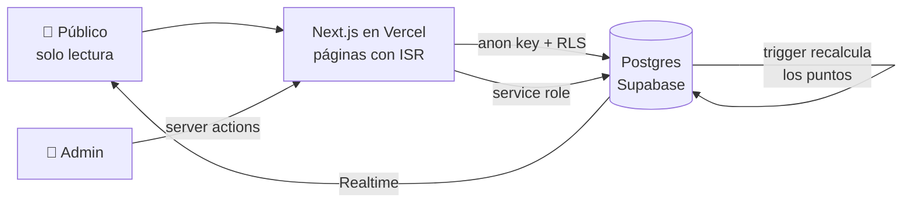

<div align="center">

# 🏆 Quiniela Hunters · Mundial 2026

**Quiniela de la fase de grupos del Mundial FIFA 2026 entre 9 amigos: 72 partidos, puntaje automático y tabla de posiciones pública.**

[](https://quiniela-hazel-five.vercel.app)
[](https://github.com/DylanSrz/quiniela/actions/workflows/ci.yml)

</div>

---

## 💡 El problema y la solución

Llevar una quiniela en un Excel compartido implica calcular a mano los puntos de 9 personas en 72 partidos, con errores y discusiones. Quiniela Hunters mueve ese cálculo a la base de datos: el administrador guarda un resultado y los puntos y la tabla se actualizan solos.

El proyecto se usó durante toda la fase de grupos y ya terminó: la demo muestra la tabla final, con los 72 partidos jugados.

## 📸 Capturas

| Tabla de posiciones | Partidos | Estadísticas |
|---|---|---|
|  |  |  |

## ✨ Funcionalidades

- **Tabla de posiciones** con podio, desempates y cambio de posición frente a la jornada anterior.
- **Partidos y grupos**: resultados, pronósticos de cada participante y posiciones por grupo.
- **Comparar** los pronósticos de 2 o más participantes y consultar **estadísticas** generales.
- **Carga de pronósticos desde Excel** con vista previa: empareja cada fila por grupo, jornada y equipos antes de guardar.
- **Actualización en vivo** con Supabase Realtime, más una consulta periódica de respaldo.
- **Panel `/admin`** protegido con contraseña y sesión firmada con HMAC.
- **Endpoint público** `/api/quiniela` con la tabla en JSON, que consumía un comando de Discord.

## 🎯 Reglas de puntuación

| Acierto | Puntos |
|---|---|
| Marcador exacto | 3 |
| Ganador acertado, sin marcador exacto | 1.5 |
| Empate acertado, sin marcador exacto | 1 |
| Nada | 0 |

Desempate: más marcadores exactos y luego más resultados acertados.

## 🏗️ Arquitectura



Modelo **admin-céntrico**: no hay registro de usuarios. Solo el administrador escribe y el resto del sitio es público y de solo lectura.

Decisiones principales:

- **El puntaje vive en Postgres.** Un trigger recalcula los pronósticos al guardar un resultado, así la tabla siempre queda consistente.
- **RLS como barrera.** La llave pública solo puede leer. Las escrituras pasan por server actions con la service role, y cada acción valida la sesión.
- **Páginas con ISR.** Se regeneran cada 30 segundos y sirven contenido en caché.

El esquema completo está en [`supabase/schema.sql`](supabase/schema.sql).

## 🛠️ Stack

| Tecnología | Uso |
|---|---|
| **Next.js 16 (App Router) + React 19 + TypeScript** | Sitio público, panel admin y server actions |
| **Tailwind CSS v4** | Estilos |
| **Supabase (Postgres, RLS, Realtime)** | Datos, permisos, trigger de puntos y actualización en vivo |
| **`read-excel-file`** | Lectura de los Excel de pronósticos en el navegador |
| **Vitest + GitHub Actions** | Pruebas unitarias, lint y typecheck en cada push y PR |
| **Vercel** | Despliegue |

## 🚀 Instalación local

**Requisitos:** Node.js 20+ y un proyecto de Supabase.

1. Clona e instala:

   ```bash
   git clone https://github.com/DylanSrz/quiniela.git
   cd quiniela
   npm install
   ```

2. En el SQL Editor de Supabase ejecuta, en este orden, `supabase/schema.sql`, `scripts/seed-matches.sql` y `scripts/update-kickoffs.sql`.

3. Copia `.env.example` a `.env.local` y completa los valores.

4. Levanta el proyecto en [http://localhost:3000](http://localhost:3000):

   ```bash
   npm run dev
   ```

**Revisiones:**

```bash
npm test
npm run lint
npm run typecheck
```

## 📁 Estructura

```
├── app/          # Páginas públicas, panel /admin, login y API
├── components/   # Vista de partidos, carga de Excel, actualización en vivo
├── lib/          # Cálculo de posiciones, estadísticas, clientes de Supabase (con pruebas)
├── scripts/      # Generadores y datos semilla en SQL
├── supabase/     # Esquema: tablas, trigger y políticas RLS
└── proxy.ts      # Protección de las rutas /admin
```

## 📄 Licencia

[MIT](LICENSE)
